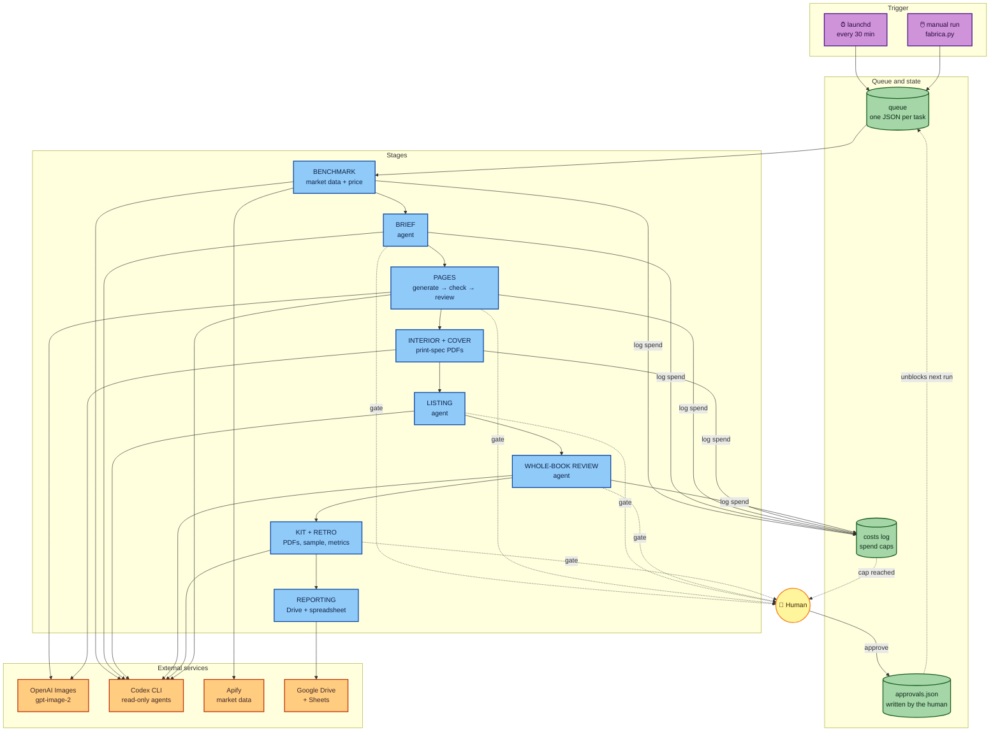

# Coloring Book Factory

A mostly autonomous pipeline that researches the market, draws, reviews and packages adult coloring books. AI agents do the work; a human approves every step that spends money or goes public. It runs on a spare MacBook Air, every 30 minutes, with no server and no cloud bill.

> **Source-available, not open source.** Free for personal and noncommercial use under the [PolyForm Noncommercial License 1.0.0](LICENSE). Want to use it commercially, or have a pipeline like this built for you? See [Work with me](#work-with-me).

## At a glance

| | |
|---|---|
| **Input** | A one-line book idea (theme, audience, page count) dropped in a queue |
| **Output** | A print-ready paperback kit (interior + cover PDFs), a printable Letter PDF, a free 5-page sample, listing copy, and, through a separate script, an Etsy listing draft |
| **Agents** | Market analyst, editor (brief and listing), page checker, whole-book reviewer, retro coach |
| **Human gates** | Brief, failed pages, price, final review, spend caps, upload |
| **Cost per book** | About USD 0.02 per page image and USD 0.06 per cover image, plus market data; the language-model agents run on a flat subscription |
| **Spend caps** | USD 2 per book and USD 10 per month without asking |

> **Status (November 2026):** first book shipped. *Cozy Little Corners* (50 bold and easy pages, Toffee Tabby collection) is live on Gumroad as a [printable book](https://cleitonsenaa.gumroad.com/l/cozy-coloring-book-printable) and a [free sample](https://cleitonsenaa.gumroad.com/l/free-cozy-coloring-pages). The Etsy listing is a draft and the paperback kit is ready for upload, both waiting on the human.

## Pipeline

| Step | Stage | What it does | Code |
|---|---|---|---|
| 1 | **Benchmark** | Pulls competitor coloring books (price, rating, reviews, sales rank, monthly buys). Proposes a price below the median that still pays back the production cost on the first sale. A market-analyst agent turns the data into themes, cover direction and page style | `fabrica.py`, `benchmark`, `preco_abaixo`, `mercado_amazon*.py` |
| 2 | **Brief** | The editor agent writes the title, page list and cover texts from the benchmark and the lessons of earlier books. Needs a human yes and a brand name | `fabrica.py` |
| 3 | **Pages** | Each page is generated, auto-checked, then judged by a reviewer agent that sees the image. Failures are redrawn up to 3 times, then go to a human queue | `linha.py`, `gerar_imagem.py` |
| 4 | **Interior** | Approved pages upscaled to 300 dpi line art and assembled into the paperback interior | `montar.py` |
| 5 | **Cover** | Cover art generated, then title, subtitle and spine laid out to the print spec (bleed, spine width per page count, safe zones) | `capa_final.py`, `montar.py` |
| 6 | **Listing** | The editor agent writes the title, subtitle, description, keywords and categories, with AI disclosure | `fabrica.py` |
| 7 | **Whole-book review** | A reviewer agent sees every page, the cover and the listing at once and sends weak pages back, once | `fabrica.py` |
| 8 | **Archive** | Finished book copied to a folder of ready books | `fabrica.py` |
| 9 | **Kit** | Upload checklist, printable PDF and free sample | `fabrica.py`, `imprimivel.py` |
| 10 | **Retro** | Cost per approved page and first-pass approval rate, compared with earlier books. A retro agent writes lessons that feed the next brief | `fabrica.py`, `retro`, `metricas` |
| 11 | **Reporting** | Uploads the files to Google Drive and rebuilds a spreadsheet with one column per book: costs, price, net per sale, payback | `fabrica.py`, `planilha.py`, `gsheets.py` |
| ✋ | **Upload** | The human uploads to the marketplace. The factory never publishes | human |

A second task type, **research**, studies a niche (keywords → market data → analyst verdict with a confidence score) and stops at a "do we enter?" gate.

## Architecture



## State machines

**Task** (one file in the queue). Every run picks up where the last one stopped.

```
            ┌──────────── human approves in approvals.json ────────────┐
            ▼                                                          │
queued ──► running ──┬──► gate (waiting on human) ─────────────────────┘
                     ├──► error (shown to the human; other tasks keep going)
                     └──► done
```

**Page** (one entry in the book's `estado.json`)

```
pending ──► generated ──► auto-check ──┬──► reviewer agent ──┬──► approved ──► upscaled to 300 dpi
                ▲                       │                     │
                └──── redraw (max 3) ───┴─────── fail ────────┘
                                                  │
                                         3rd fail ▼
                                            human queue
```

**Human gates**

| Gate | Fires when | Human decides |
|---|---|---|
| `brief` | The brief is written | Approve or edit the page list, set the brand name |
| `teto_livro` / `teto_mes` | Next step would pass USD 2 per book or USD 10 per month | Allow the spend or stop |
| `paginas_falhadas` | Pages failed 3 times | Redraw, drop or accept |
| `preco` | No price under the competitor median pays back the production cost | Pick a price or drop the book |
| `revisao_final` | Whole-book reviewer scores the book below the bar | Fix or accept |
| `upload` | Kit is ready | Review and upload to the marketplace |
| `decidir` | A niche research task is done | Enter the niche or not |

## Rules the bots never break

1. **Never** create accounts, pay, publish or contact anyone. Those are human actions.
2. **Never** read, write or ask for passwords or keys. Keys live outside the repo (`chmod 600` files or the OS keychain) and are never printed.
3. **Never** browse or scrape the marketplace directly. Market data comes from a third-party data provider.
4. **Never** invent a number. Every figure has a source link or is labelled as an estimate.
5. **Never** pass the spend caps without a human yes.

## Repo structure

```
coloring-book-factory/
├── bin/
│   ├── fabrica.py           # orchestrator: queue, stages, gates, spend caps, reports
│   ├── linha.py             # page line: generate → auto-check → reviewer agent → redraw
│   ├── gerar_imagem.py      # OpenAI Images API, one page
│   ├── editar_imagem.py     # OpenAI Images API, edit or extend an image
│   ├── montar.py            # paperback interior + cover PDFs (trim, bleed, spine)
│   ├── capa_final.py        # cover typography and layout
│   ├── imprimivel.py        # printable Letter PDF and free sample
│   ├── mercado_amazon.py    # market data via Apify (niche analyzer actor)
│   ├── mercado_amazon2.py   # market data via Apify (sales rank, monthly buys)
│   ├── planilha.py          # one-column-per-book reporting sheet
│   ├── gsheets.py           # Google Sheets access through the rclone token
│   └── etsy_rascunho.py     # Etsy listing DRAFT (OAuth 2.0 + PKCE); no publish call
├── experiments/             # throwaway proof sheets used to pick the cover and fonts
├── examples/
│   └── livro-modelo.json    # book template: style prompt, pages, copyright
├── launchd/
│   └── com.example.fabrica.plist   # runs the factory every 30 min
├── LICENSE                  # PolyForm Noncommercial 1.0.0
└── README.md
```

Code comments and agent prompts are in Portuguese.

## Stack

| Layer | Tool |
|---|---|
| Language | Python 3 standard library + Pillow |
| Images | OpenAI Images API (`gpt-image-2`) |
| Agents | Codex CLI in read-only mode, JSON-schema outputs |
| Market data | Apify actors |
| Files and reporting | rclone + Google Drive + Google Sheets API |
| Marketplace draft | Etsy Open API v3 |
| Scheduling | macOS launchd |

## Local run

This is a working personal setup, not a packaged tool. Paths assume `~/livros` (books and `bin/`) and `~/empresa` (queue, costs, `config.json`).

```bash
pip install pillow            # plus the Codex CLI and rclone

# keys live outside the repo, one per file, chmod 600 (see each script's docstring)
#   ~/.openai-imagens   ~/.apify-pessoal   rclone remote "pessoal"

mkdir -p ~/livros/my-book ~/empresa/fila
cp examples/livro-modelo.json ~/livros/my-book/livro.json
echo '{"tipo": "livro", "pasta": "~/livros/my-book"}' > ~/empresa/fila/001-my-book.json

python3 bin/fabrica.py        # one pass: runs until done or a gate
python3 bin/linha.py ~/livros/my-book      # just the page line for one book
python3 bin/montar.py interior ~/livros/my-book
python3 bin/imprimivel.py ~/livros/my-book --amostra 5   # free sample
```

Approve a gate by adding its key to `~/livros/my-book/aprovacoes.json`, for example `{"brief": true}`. To run it on a schedule, copy `launchd/com.example.fabrica.plist` to `~/Library/LaunchAgents/`, replace `YOU` with your user, and load it.

## Work with me

The license allows personal use, study, hobby projects and use by noncommercial organizations. Any commercial use needs a separate paid license.

If you want to use this commercially, collaborate, or have a similar pipeline built for your business:

[LinkedIn](https://www.linkedin.com/in/cleiton-sena/) | [GitHub](https://github.com/cleitonsena) | [DEV](https://dev.to/cleitonsena) | [X](https://x.com/cleitonsenaes) | [Instagram](https://www.instagram.com/cleitonsenaes/)

## License

[PolyForm Noncommercial License 1.0.0](LICENSE)

Required Notice: Copyright 2026 Cleiton Sena (https://github.com/cleitonsena)
