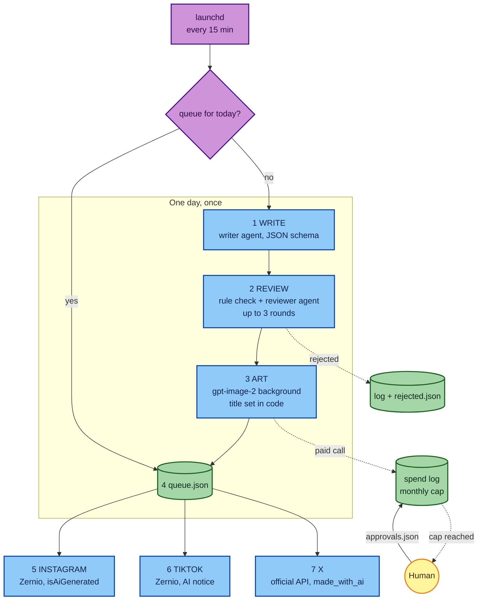

# Messenger Carousels

An autonomous pipeline that writes, reviews and draws motivational carousels for the profile **Your Bestie, The Messenger** ([@yourbestiethemessenger](https://www.instagram.com/yourbestiethemessenger/) on Instagram and TikTok, [@bestiemessenger](https://x.com/bestiemessenger) on X). AI agents write and review the copy, an image model draws the backgrounds, the titles are set in code, and the posts are scheduled on Instagram and TikTok through Zernio and posted on X through the official API. It runs every 15 minutes from macOS launchd, with no server.

> **Source-available, not open source.** Free for personal and noncommercial use under the [PolyForm Noncommercial License 1.0.0](LICENSE). Want to use it commercially, or have a pipeline like this built for you? See [Work with me](#work-with-me).

## At a glance

| | |
|---|---|
| **Input** | None per day. The writer agent reads the profile rules, the reference notes and the history of past posts |
| **Output** | 3 carousels a day (3 message slides + 1 call-to-action slide, 1080x1350 JPEG), posted at 15:30, 18:30 and 21:30 on Instagram, TikTok and X |
| **Agents** | Writer, reviewer, plus a deterministic rule check in code |
| **Human role** | Creates the accounts, developer apps and payments, saves the keys, approves spend above the monthly cap, checks the first real post on each network by eye |
| **Cost** | About USD 0.0067 per background image (`gpt-image-2`, low quality) and about USD 0.015 per X post; the language model runs on a free tier |
| **Spend cap** | USD 10.5 per month by default (set per month in code); above it only with an explicit approval |
| **AI disclosure** | Every post is labelled as AI on every network: `isAiGenerated` on Instagram, a notice in the caption on TikTok, `made_with_ai` plus a notice in the text on X |

> **Status (November 2026):** first real test on 26 Nov 2026. One carousel went out on X, Instagram and TikTok through the APIs; the Instagram AI label and the TikTok music were checked by eye.

## Pipeline

| Step | Stage | What it does | Code |
|---|---|---|---|
| 1 | **Write** | The writer agent drafts 3 carousels in English: slide lines, scene for each background, TikTok title, caption, X text and a comment word, as JSON against a schema. It must not repeat any theme or hook in the history | `carousel_auto.py`, `script` |
| 2 | **Review** | Each carousel goes through a rule check in code (forbidden words, lengths, emoji count, follow line) and a strict reviewer agent. Rejected carousels are rewritten, up to 3 rounds, and logged | `carousel_auto.py`, `rules`, `script` |
| 3 | **Art** | One background per slide from `gpt-image-2` with no text, leaving an empty zone for the title. The title, label and handle are set in code. A fourth call-to-action slide is drawn in code with its own icons | `carousel_auto.py`, `art`, `carousel_art.py`, `typography.py` |
| 4 | **Queue** | The day's carousels are written to `queue.json` with captions per network, the AI notice and a time slot | `carousel_auto.py`, `generate` |
| 5 | **Instagram** | Images uploaded once to Zernio for hosting; carousel scheduled with the AI label | `connectors.py`, `instagram` |
| 6 | **TikTok** | Photo post scheduled through Zernio, public, with automatic music and the AI notice in the caption | `connectors.py`, `tiktok` |
| 7 | **X** | At the slot time, the 4 images are uploaded and the post goes out with `made_with_ai` | `connectors.py`, `x` |
| 8 | **Log** | Every state change goes to a log; every paid call goes to a spend log checked against the monthly cap | `carousel_auto.py`, `log`, `spend` |

## Architecture



Each run builds the day once (after 08:00), then moves every post forward on every network. Instagram and TikTok are scheduled ahead through Zernio; X is posted at the slot time. If building the day fails, a `.failed` marker pauses retries for one hour.

## State machines

**Day** (one folder per date)

```
no queue ──► write ──► review ──┬──► art ──► queue.json
                ▲               │
                └── rewrite ────┤ (up to 3 rounds)
                                └──► nothing approved: empty queue, nothing goes out
error ──► .failed marker ──► retry after 1 hour
```

**Post on one network** (one entry in `queue.json`)

```
pending ──┬──► dry-run (no key yet; retried every cycle)
          ├──► scheduled   (Instagram, TikTok via Zernio)
          ├──► done        (X)
          └──► error ──► retry (max 4 attempts) ──► final-error
late: more than 30 min past the slot (Instagram, TikTok) or 2 h (X) ──► final-error, never published late
```

**Human gates**

| Gate | Fires when | Human decides |
|---|---|---|
| Keys | A network has no key | Create the account and app, pay, save the key (see [docs/setup-apis.md](docs/setup-apis.md)) |
| `month_cap_YYYY-MM` | The next images would pass the monthly cap | Approve the spend in `~/company/approvals.json` or let the day stop |
| First post | A network publishes for the first time | Check it by eye |

There is no post-by-post approval. The reviewer (agent plus rule check) is the gate: a carousel that fails it never goes out and is logged.

## Rules the bots never break

1. **Never** create accounts, pay or handle passwords. Accounts, developer apps and payments are human actions.
2. **Never** print a key. Keys live outside the repo, one per `chmod 600` file.
3. **Never** publish through a browser. Only through Zernio and the official X API.
4. **Never** publish a carousel that failed the review: no promise of results, no health or healing claims, no pseudo-science, no real brands, people, books or religions, no phrases copied from reference profiles, nothing about the reader's body.
5. **Never** publish without the AI label or notice.
6. **Never** publish late, and **never** pass the monthly spend cap without a human yes.

## Repo structure

```
messenger-carousels/
├── bin/
│   ├── carousel_auto.py     # orchestrator: write, review, art, queue, cycle, spend cap, status
│   ├── carousel_art.py      # slide layout: background crop, veil, title, label, handle, CTA slide, icons
│   ├── connectors.py        # Zernio (Instagram, TikTok, image hosting) and X (OAuth 1.0a); stdlib only
│   ├── typography.py        # lettering design system: styles, text masks, ink, paper, sample sheet
│   ├── effects.py           # text effects in code: circle, bend, emboss
│   └── x_pin.py             # X access token by PIN for the posting account
├── docs/
│   ├── setup-apis.md        # which keys to create and where to save them
│   └── design-system.md     # poster and carousel design rules
├── launchd/
│   └── com.example.carousels.plist   # runs the cycle every 15 min
├── LICENSE                  # PolyForm Noncommercial 1.0.0
└── README.md
```

## Stack

| Layer | Tool |
|---|---|
| Language | Python 3 standard library + Pillow + NumPy |
| Writer and reviewer agents | Gemini free tier through `gemini_json.py` (google-genai SDK), JSON-schema outputs |
| Images | OpenAI Images API (`gpt-image-2`) through `generate_image.py` |
| Fonts | Della Respira, Young Serif, Fraunces (OFL) |
| Instagram, TikTok, image hosting | Zernio API (free plan, 2 accounts) |
| X | X API v2 (pay per use), OAuth 1.0a |
| Scheduling | macOS launchd |

`gemini_json.py` and `generate_image.py` come from the sibling [coloring-book-factory](../coloring-book-factory/) and are expected in `~/books/bin/`.

## Local run

This is a working personal setup, not a packaged tool. Paths assume `~/company` (log, spend log, approvals, rules and history), `~/books` (shared `bin/` and `fonts/`) and `~/prototypes/posters/auto` (one folder of images and `queue.json` per day). The writer agent also reads private rule and reference files under `~/company/decisions/` and `~/company/projects/posters/`, which are not part of this repo.

```bash
pip install pillow numpy      # plus ~/.venv-genai with google-genai for gemini_json.py

# keys live outside the repo, one per file, chmod 600 (see docs/setup-apis.md)
#   ~/.zernio-key   ~/.x-ck   ~/.x-cs   ~/.x-at   ~/.x-as   ~/.openai-images

mkdir -p ~/company/projects/posters ~/prototypes/posters/auto
cp bin/*.py ~/company/projects/posters/

python3 bin/carousel_auto.py generate            # build today's 3 carousels (no publishing)
python3 bin/carousel_auto.py status              # state per post and network
python3 bin/carousel_auto.py cycle               # one pass: build if needed, schedule and publish what is due
python3 bin/typography.py /tmp/ds1               # lettering sample sheet
python3 bin/effects.py /tmp/effects1             # text effects sample sheet
X_SCREEN_NAME=your_handle python3 bin/x_pin.py   # X access token by PIN
```

Without keys every network stays in `dry-run`, so you can run the whole cycle without publishing anything. To run it on a schedule, copy `launchd/com.example.carousels.plist` to `~/Library/LaunchAgents/`, replace `YOU` with your user, and load it.

## Work with me

The license allows personal use, study, hobby projects and use by noncommercial organizations. Any commercial use needs a separate paid license.

If you want to use this commercially, collaborate, or have a similar pipeline built for your business:

[LinkedIn](https://www.linkedin.com/in/cleiton-sena/) | [GitHub](https://github.com/cleitonsena) | [DEV](https://dev.to/cleitonsena) | [X](https://x.com/cleitonsenaes) | [Instagram](https://www.instagram.com/cleitonsenaes/)

## License

[PolyForm Noncommercial License 1.0.0](LICENSE)

Required Notice: Copyright 2026 Cleiton Sena (https://github.com/cleitonsena)
